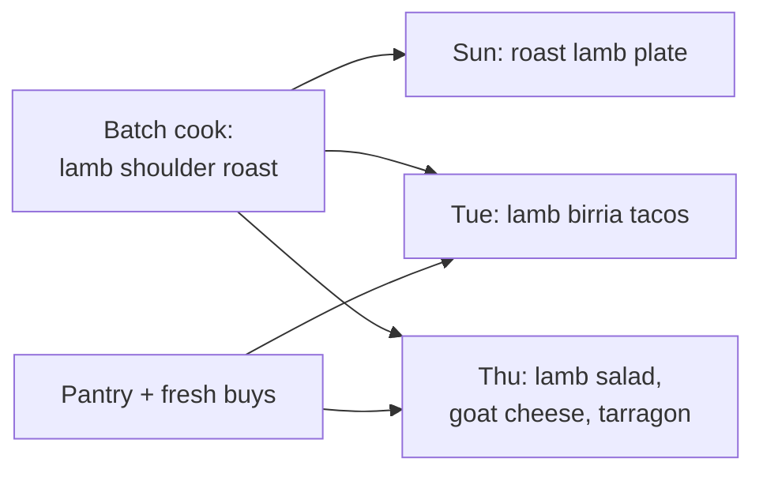

# mealstack

mealstack is the anti–meal kit. A meal kit ships one nub of honey for one recipe; mealstack repurposes a few batch cooks into a week of different meals.

## Who it's for

Confident home cooks. Not for someone who needs step-by-step recipes or pre-portioned ingredients.

## Vocabulary

| Term | Meaning |
| --- | --- |
| **Batch cook** | A cooking session that produces more than one meal's worth of food. |
| **Component** | A cooked ingredient a batch cook produces: roast lamb, braised beans, pickled onions. |
| **Meal** | What gets eaten. Combines components with pantry staples and fresh buys. |
| **Repurpose** | Turning a component into a meal that is a different dish, not a reheat of the same one. |
| **Plan** | A week of meals, the batch cooks behind them, and the shopping they need. |

## Status

Pre-design. No stack chosen yet.

Process, proposals, and progress live in Linear (mealstack project, Schwamilton workspace).
