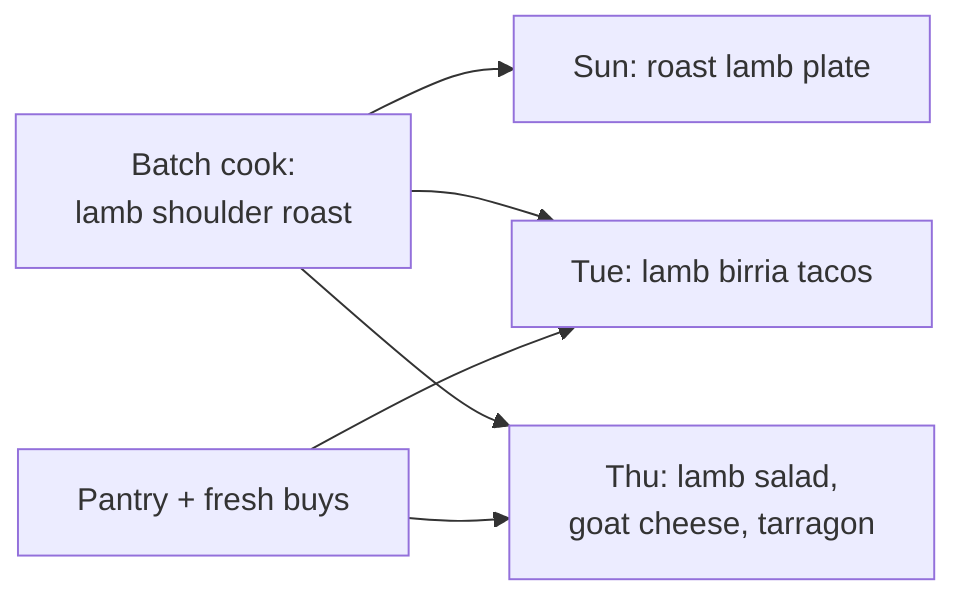

# mealstack

Plan a week of home-cooked meals around a few good batch cooks, and reuse everything.

mealstack is the anti–meal kit. A meal kit ships you exactly one nub of honey for one recipe. mealstack assumes you already shop and cook well, and helps you get the most out of what you make: a few batch cooks per week, each repurposed into meals that don't taste like leftovers.

A lamb shoulder roast is Sunday's plate meal. Its leftovers become Tuesday's lamb birria tacos, then Thursday's salad with lamb, goat cheese, and tarragon.

## Who it's for

Cooks who are comfortable shopping and cooking, who want a few high-leverage cooking sessions per week, and who would rather eat three different meals than the same leftovers three times. It is not for someone who needs step-by-step recipes or pre-portioned ingredients.

## Vocabulary

These terms are early and will change, but use them consistently until they do.

| Term | Meaning |
| --- | --- |
| **Batch cook** | A cooking session that produces more than one meal's worth of food. |
| **Component** | A cooked ingredient a batch cook produces: roast lamb, braised beans, pickled onions. |
| **Meal** | What gets eaten. Combines components with pantry staples and fresh buys. |
| **Repurpose** | Turning a component into a meal that is a different dish, not a reheat of the same one. |
| **Plan** | A week of meals, the batch cooks behind them, and the shopping they need. |

## Ways of working

### Everything is tracked in Linear

The project is **mealstack** in the Schwamilton Linear workspace. Linear is the source of truth for what is in flight; the repo is the source of truth for what is decided and built.

- Every piece of work has a Linear issue. Every agent conversation is linked from its issue, so any conversation can be found and resumed.
- An agent conversation that starts without an issue gets one as soon as it is more than a quick answer. The issue records the goal, the current state, and a link to the conversation.
- Commits and PRs reference their issue ID.
- Project structure (milestones, labels, sub-projects) emerges from use. Add structure when it is evidently useful, not before.

### Design before implementation

Attention is the bottleneck, and the best use of it is review and iteration at the design level. Nontrivial work starts with a design doc in [`docs/design/`](docs/design/), and implementation starts once the design is agreed.

Design docs have two layers:

- **Above the fold** is what a reviewer reads to make the decision: the problem in 3–5 bullets, the system shape in exec-digestible terms, and high-level diagrams (sequence, flow, ERD). It avoids code names and detail that wouldn't change a decision at this altitude.
- **Below the fold** holds everything else: data models, interfaces, alternatives considered, open questions, and the plan.

Align on the problem bullets before writing the rest. A wrong problem statement makes everything below it wasted work. Start from [the template](docs/design/0000-template.md).

### Phone-first review

Development is driven from a phone. Prefer artifacts that read well on a small screen: short sections, tables over prose for comparisons, Mermaid diagrams over images, and PRs small enough to review in one sitting.

## Status

Pre-design. No stack chosen yet.
