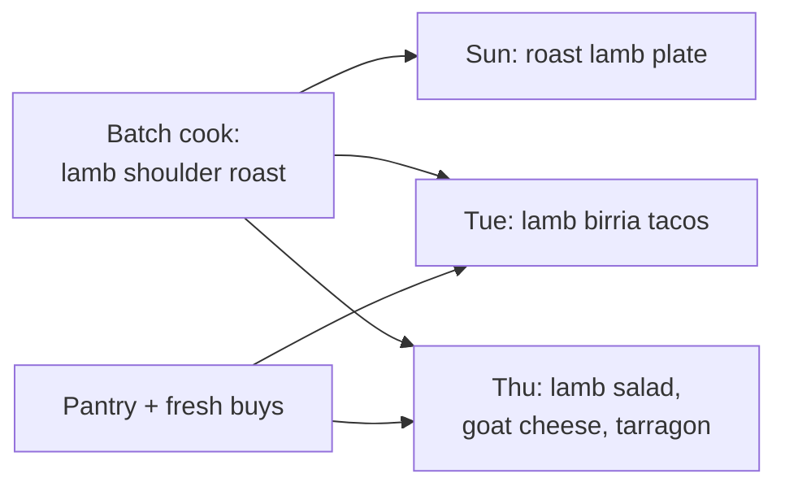

# mealstack

Plan a week of home-cooked meals around a few good batch cooks, and reuse everything.

mealstack is the anti–meal kit. A meal kit ships you exactly one nub of honey for one recipe. mealstack assumes you already shop and cook well, and helps you get the most out of what you make: a few batch cooks per week, each repurposed into meals that don't taste like leftovers.

A lamb shoulder roast is Sunday's plate meal. Its leftovers become Tuesday's lamb birria tacos, then Thursday's salad with lamb, goat cheese, and tarragon.

## Who it's for

Cooks who are comfortable shopping and cooking, who want a few high-leverage cooking sessions per week, and who would rather eat three different meals than the same leftovers three times. It is not for someone who needs step-by-step recipes or pre-portioned ingredients.

## Vocabulary

These terms are early and will change, but use them consistently until they do.

| Term | Meaning |
| --- | --- |
| **Batch cook** | A cooking session that produces more than one meal's worth of food. |
| **Component** | A cooked ingredient a batch cook produces: roast lamb, braised beans, pickled onions. |
| **Meal** | What gets eaten. Combines components with pantry staples and fresh buys. |
| **Repurpose** | Turning a component into a meal that is a different dish, not a reheat of the same one. |
| **Plan** | A week of meals, the batch cooks behind them, and the shopping they need. |

## Ways of working

Work is tracked in the **mealstack** project in the Schwamilton Linear workspace. Process details and progress live there, not in this repo; read the project's **Ways of working** doc before starting work.

The parts that touch the repo:

- **Design before implementation.** Nontrivial work starts with a design doc, reviewed in stages from problem to architecture. See [`docs/design/`](docs/design/README.md).
- **Small PRs.** Review happens on a phone. Keep PRs reviewable in one sitting, and reference the Linear issue ID in commits and PRs.

## Status

Pre-design. No stack chosen yet.
