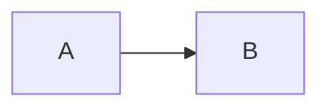

# NNNN: Title

**Status:** Problem review | Shape review | UX review | Architecture review | Agreed | Superseded by NNNN
**Issue:** LINEAR-ID

<!-- See README.md in this folder. Write and review one stage at a time. -->

## Problem

<!-- 3–5 bullets: what is wrong or missing, and why it matters. If it doesn't fit, it may be a wish list. -->

-
-
-

## North stars

<!-- A few bullets, linked to any north star docs. The proposal aligns with them or deviates on purpose (say which). -->

-

## System shape

<!-- The moving parts, what each is responsible for, and how they connect, in terms an exec could follow. No specific tools, method names, or code exploration. -->

<!-- Stop here and get review before writing below the fold. -->

---

## UX

<!-- Flows, scenarios, screens. Review before architecture. -->

## Architecture

<!-- Deeper diagrams, data model, edge cases, error handling, performance, integration, rollout. -->

## Alternatives considered

## Open questions

## Plan

## Appendix: Decision log

<!-- Dated one-liners: what was decided and why. Superseded options move here so the body stays the current design. -->

- YYYY-MM-DD:
