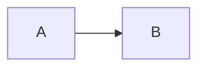

# NNNN: Title

**Status:** Draft | In review | Agreed | Superseded by NNNN
**Issue:** [LINEAR-ID](link)

## Problem

<!-- 3–5 bullets. What is wrong or missing, and why it matters. Get agreement here before writing the rest. -->

-
-
-

## System shape

<!-- A few sentences an exec could follow: the moving parts, what each is responsible for, and how they connect. No code names. -->

## Diagrams

<!-- Sequence, flow, or ERD in Mermaid. Only what supports the decision. -->

---

<!-- Below the fold: everything a reviewer may want but doesn't need to make the decision. -->

## Details

## Alternatives considered

## Open questions

## Plan
